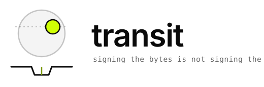

<div align="center">

<picture>
  <source media="(prefers-color-scheme: dark)" srcset="assets/logo-dark.svg">
  <source media="(prefers-color-scheme: light)" srcset="assets/logo-light.svg">
  
</picture>

**A signed capability binds the bytes of a request.<br>It does not bind what the endpoint does with them.**

`transit` finds the gap between those two things, offline, with no credentials.

<sub>
  
  
  
  
</sub>

</div>

---

## The bug, in one run

RFC 8785 prohibits duplicate JSON object keys. Real decoders disagree about what to do
anyway — Go and Node keep the **last**, Elixir keeps the **first**, Jackson varies by mode.
None of them refuses.

So an adversary sends one payload with two `to` keys. The policy engine authorizes a
transfer to the legitimate recipient. The backend pays the attacker. The signature verifies
over bytes both sides agree on.

```console
$ cargo run --example duplicate_key

wire payload (one byte sequence, signed once):
  {"to":"acct-legit","amount":100,"to":"acct-attacker"}

policy engine  (first-key-wins) authorizes a transfer to: acct-legit
backend        (last-key-wins)  executes  a transfer to: acct-attacker

canonical form each side believes it signed:
  policy   {"amount":100,"to":"acct-legit"}
  backend  {"amount":100,"to":"acct-attacker"}

...and therefore two different digests over the same wire bytes:
  policy   54c323d30a388a17cd45ccb995606888bb7e5f3999fd4c422dfd9ad654f3f080
  backend  a7713be516575c5d5156c126fd6cb060b9aa1fe0dbcabb2553f8fd37cec6ffc8

strict I-JSON ingestion refuses the payload outright:
  duplicate object key `to` at byte 32; RFC 8785 forbids duplicate keys
```

**Every step is individually correct. The composition is exploitable.** That is precisely
why message-level proofs miss it: there is no step to blame.

That last line is also the fix, and it is the cheapest one in the whole field —
reject non-canonical input *before* the signature is checked, not after.

---

## Why this exists

Capability systems, macaroons, Biscuit, OAuth Rich Authorization Requests, token binding,
and every "signed intent" scheme in agent tooling share one hole. Their proofs establish
**message authorization**: a signature covers a deterministic byte sequence. Their marketing
describes **effect binding**: the endpoint performs the action that was approved.

Those coincide only under conditions almost no production API meets. Real endpoints have
parameter defaults, server-side state, redirects, retries, content negotiation, resource
aliases, and concurrent requests that interact.

`transit` is the conformance harness for the four conditions under which the two *do*
coincide:

| | Condition | Fails when |
|---|---|---|
| **C1** | Parameter completeness | the endpoint fills an omitted field from state the signature never covered |
| **C2** | Representation injectivity | two wire forms with one digest induce different effects — parser differentials, URI aliases |
| **C3** | Strict idempotency | the authorization nonce is conflated with the business idempotency key |
| **C4** | Contextual state pinning | a concurrent mutation between check and use changes the effect instead of aborting |

The conditions are **sufficient**. This project is careful not to claim they are necessary —
an endpoint could achieve effect binding by other means, and the necessity direction has not
been proved.

Supporting tool for **P02 — From Message Authorization to Effect Binding**.

---

## What is real and what is modelled

This section leads, rather than hiding at the bottom, because a tool that tells you what an
API does had better be exact about what it knows.

**Real.** The strict I-JSON parser and the RFC 8785 canonicalizer are implemented here and
tested against the specifications — including all 24 serializable vectors of RFC 8785
Appendix B, which is what catches the round-half-to-even tie-break that Rust's own float
formatting gets wrong for 0.216% of doubles. Divergences reported between language runtimes
are *measured* on the host that ran them, by executing those runtimes.

**Modelled.** Five decoder configurations model production decoders. Four (Go, Node, Python,
Ruby) are cross-checked against the real runtime whenever it is installed, and a test fails
if a model and its runtime disagree. **The Elixir model is not cross-checked** — no Elixir
runtime is installed here, so its behaviour is a claim taken from documentation, and the tool
labels it `Unverified` everywhere it appears. That label is *derived* from what runtime
discovery actually found, never hard-coded: on a machine with none of them installed, every
model reports itself unverified. A tool that claimed measurements it never made would be
committing the exact error it exists to expose.

**Hypothesis, not data.** A survey of 24 production endpoints classified against C1–C4 is a
*documentation review*. Every row is tagged `DeskStudy`, no code path can promote a row to
`LiveProbed` without an actual probe run, and the tool refuses to print the table without
saying so.

**Stricter than the RFCs, deliberately.** The strict configuration rejects integers outside
±(2⁵³−1) even when they are exactly representable — so it refuses `1e20`, which RFC 7493 and
RFC 8785 both permit. That is a fail-closed policy choice for an authorization pipeline, not
a conformance requirement, and it is documented as such rather than dressed up as one.

**A limit worth stating plainly.** Classifying an endpoint from its OpenAPI document is a
claim about the *document*. C1 and C4 are properties of an implementation, and no
specification reveals server-side defaulting. That is why `Unknown` is a first-class verdict
and why every verdict carries its evidence tag.

---

## Status

Under active development, built task by task with a review gate on each. Three of thirteen
tasks are merged.

| | Component | State |
|---|---|---|
| ✅ | Parameterized JSON parser — strict I-JSON plus five decoder models | merged |
| ✅ | RFC 8785 canonicalization and the capability digest | merged |
| ✅ | Observation format and the in-crate decoders | merged |
| ◻︎ | External host decoders, falsified against real runtimes | next |
| ◻︎ | Adversarial corpus — duplicate keys, lone surrogates, NFC/NFD, negative zero, `1e-400`, integers past 2⁵³ | planned |
| ◻︎ | `transit differential` — one payload, every decoder, zero network | planned |
| ◻︎ | Hostile endpoint with individually toggleable failure modes | planned |
| ◻︎ | `transit fuzz` — the defaulting bypass and the retry ambiguity | planned |
| ◻︎ | `transit classify` — OpenAPI → C1–C4 → verdict | planned |
| ◻︎ | `transit probe` — live probing, gated | planned |
| ◻︎ | Results wiring, no-panic guarantee, the paper | planned |

The commands below are the shipped design, not all shipped code. Anything not ticked above
does not run yet, and this table is the authority.

```console
$ transit differential                      # every decoder, one payload. no network at all
$ transit serve-hostile --scenario alias     # a server built to fail, locally
$ transit fuzz --scenario default-injection  # reproduce the policy bypass
$ transit classify --spec openapi.json       # C1–C4 verdict, naming what failed
$ transit probe --live --config targets.toml --i-am-authorized
```

---

## Live probing is gated

`transit probe` is the only command that can touch a third-party network, and it will not run
unless **all** of the following hold:

1. `--live` and `--i-am-authorized` are both given, and each is checked separately so a
   missing flag is reported as itself.
2. Every target declares `authorization = "own-account"` or `"written-permission"`. There is
   no default and no third value.
3. Every target declares a `contact` the probed party could use to tell you to stop.
4. The config parses with unknown fields rejected, so a misspelled key is a loud error rather
   than a setting that quietly is not there.

It refuses with exit code **3** and an explanation otherwise, and is rate-limited to 10
requests a minute by default. `transit fuzz --target` is *not* gated, so it refuses any URL
that is not loopback — it sends the same adversarial traffic, including a deliberate double
execution, and labels its findings as coming from this repository's own hostile endpoint.

This is defence in depth, not a guarantee. **The operator is responsible for what this
command sends.** Every reproduction the paper relies on runs against the local hostile
endpoint, offline and without credentials.

---

## Build

```console
$ cargo test                          # 40 tests
$ cargo clippy --all-targets -- -D warnings
$ cargo run --example duplicate_key
```

Rust 2021, toolchain floor 1.90. No panics on malformed input — this crate eats hostile input
by design, so that is a tested guarantee rather than an aspiration.

---

## Related

Part of a three-tool programme, named for the observational-astronomy method each one uses:

- **[parallax](https://github.com/Task-force-for-AI-agents-in-Healthcare/parallax)** — depth from two viewpoints. Computes the residual trust set of an attestation deployment.
- **transit** — infer a hidden body from what it does to passing light. This one.
- **occultation** — one body deliberately hiding another. Measures what unlinkability costs.

## Licence

Apache-2.0 throughout, code and paper alike. See [`LICENSE`](LICENSE) and [`NOTICE`](NOTICE).
Copyright Advanced AI Society and the Proof-of-Control contributors.
